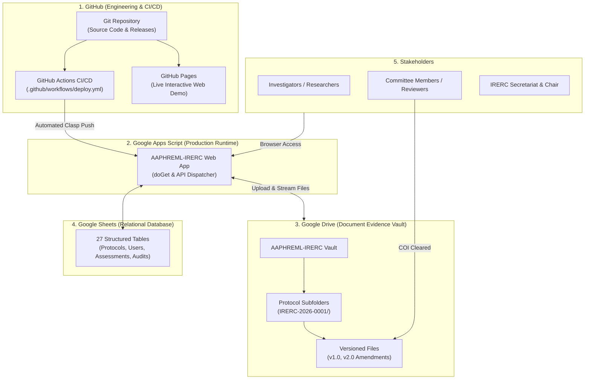

# Seamless GitHub & Google Drive Integration Guide
## AAPHREML-IRERC Research Protocol Governance Platform

**Addis Ababa City Administration Health Bureau**  
**Institutional Research Ethics Review Committee (IRERC)**  
*Federal Democratic Republic of Ethiopia*

---

## 1. Executive Summary: The Seamless Ecosystem

**Yes, the system is designed from the ground up to integrate seamlessly with both GitHub and Google Drive.**

Each platform handles the specific domain it excels at:



- **GitHub** manages the source code, version history, peer reviews, issues, and automated continuous deployment (CI/CD) to Google Apps Script. It also hosts the standalone demo live via **GitHub Pages**.
- **Google Drive** acts as the secure, institutional Document Vault for all research proposals, signed informed consent forms, investigator CVs, data collection tools, ethical approval certificates, and progress reports.
- **Google Sheets** acts as the serverless relational database engine storing all metadata, users, assignments, and audit trails.

---

## 2. GitHub Integration: Source Code, CI/CD & GitHub Pages

### A. Automatic Deployment via GitHub Actions
Every time you push changes or merge a pull request into `main`, GitHub Actions automatically pushes the code directly into your live Google Apps Script web app using **Google Clasp**.

The workflow is pre-configured in [`.github/workflows/deploy.yml`](.github/workflows/deploy.yml):

```yaml
name: Deploy to Google Apps Script
on:
  push:
    branches: [ main ]
jobs:
  deploy:
    runs-on: ubuntu-latest
    steps:
      - uses: actions/checkout@v4
      - uses: actions/setup-node@v4
        with: { node-version: '20' }
      - run: npm install -g @google/clasp
      - name: Deploy
        env:
          CLASPRC_JSON: ${{ secrets.CLASPRC_JSON }}
          SCRIPT_ID: ${{ secrets.SCRIPT_ID }}
        run: |
          echo "$CLASPRC_JSON" > ~/.clasprc.json
          clasp push --force
          clasp deploy --description "Automated deployment from GitHub commit ${{ github.sha }}"
```

#### How to Configure GitHub Actions (One-Time Setup):
1. On your local machine, install Google Clasp and log in:
   ```bash
   npm install -g @google/clasp
   clasp login
   ```
2. Open your generated authentication file:
   - On Windows: `C:\Users\<YourUser>\.clasprc.json`
   - On Mac/Linux: `~/.clasprc.json`
3. In your GitHub repository, go to **Settings** > **Secrets and variables** > **Actions** > **New repository secret**.
4. Add two secrets:
   - **`CLASPRC_JSON`**: Paste the entire JSON content of your `~/.clasprc.json` file.
   - **`SCRIPT_ID`**: Paste your Google Apps Script project ID (found in Apps Script Project Settings).
5. From now on, whenever you type `git push origin main`, your live Google Apps Script web application updates in under 60 seconds without manual copy-pasting.

---

### B. Live Public Web Demo via GitHub Pages
The repository includes [`.github/workflows/pages.yml`](.github/workflows/pages.yml), which automatically publishes the compiled [`preview.html`](preview.html) to **GitHub Pages**.

#### How to Enable GitHub Pages:
1. In your GitHub repository, navigate to **Settings** > **Pages**.
2. Under **Build and deployment** > **Source**, choose **GitHub Actions**.
3. Push to `main`.
4. Your platform will be hosted live on:
   ```
   https://<your-organization>.github.io/<your-repo-name>/
   ```
5. Anyone on the ethics committee, leadership team, or hospital management can test and review the interactive platform from any phone, tablet, or laptop immediately.

---

## 3. Google Drive Integration: Secure Protocol Vault

### A. Automatic Folder Hierarchy
When an investigator submits a research protocol (e.g. `AAPHREML-IRERC-2026-0001`), the server ([`server/Utils.gs`](server/Utils.gs#L142-L148)) automatically creates the folder structure inside Google Drive:

```
Google Drive/
└── AAPHREML_IRERC_Documents/                ← Root Folder (Config.gs: CFG.FOLDER_ID)
    ├── AAPHREML-IRERC-2026-0001/            ← Protocol Subfolder
    │   ├── AAPHREML-IRERC-2026-0001_Protocol_v1.0_Proposal.docx
    │   ├── AAPHREML-IRERC-2026-0001_InformedConsent_v1.0_Amharic.docx
    │   ├── AAPHREML-IRERC-2026-0001_Tools_v1.0_Questionnaire.docx
    │   └── AAPHREML-IRERC-2026-0001_PI_CV_BioethicsCert.docx
    ├── AAPHREML-IRERC-2026-0002/
    └── AAPHREML-IRERC-2026-0003/
```

### B. Immutable Version Control
When an investigator submits an amendment or correction:
1. The server identifies the existing document slot in the database.
2. The document version is incremented automatically (e.g., from `v1.0` to `v2.0`).
3. The revised file is saved with the new version stamp:
   `AAPHREML-IRERC-2026-0001_Protocol_v2.0_Revised_Proposal.docx`
4. The previous version (`v1.0`) is **never overwritten**—both files remain preserved in Google Drive for regulatory audits.
5. An immutable entry is recorded in the `document_versions` table and logged in the system `audit_trail`.

### C. Direct Streaming & In-Browser Viewer
In [`client/views.html`](client/views.html#L1300-L1360):
- Reviewers and committee members click **Download & Review**.
- The platform uses the secure Google Drive preview URL (`https://drive.google.com/file/d/<fileId>/view`).
- Documents open inside the browser without requiring external software.

### D. Enforced Conflict of Interest (COI) Gate
- Before a reviewer can access Google Drive links for a protocol, the platform verifies their COI clearance.
- If COI is not declared, document URLs remain locked and masked.
- Once the reviewer declares `No Conflict Declared`, the Google Drive access links activate immediately.

---

## 4. Summary of Configuration Parameters

All Drive and Spreadsheet settings are centralized in [`server/Config.gs`](server/Config.gs):

| Parameter | Description | Example Value |
|---|---|---|
| `SPREADSHEET_ID` | Google Sheet relational database ID | `1b2C3d4E5f6G7h8I9j0K...` |
| `DRIVE_FOLDER_ID` | Root Google Drive folder ID for document vault | `1xYzAbCdEfGhIjKlMnOp...` |
| `ROOT_FOLDER_NAME` | Display name of the Google Drive archive | `AAPHREML_IRERC_Documents` |
| `MAX_FILE_SIZE_MB` | Maximum allowed document upload size | `25` |
| `ALLOWED_MIME_TYPES` | Permitted upload formats for the **Proposal Structural Scanner** | **DOCX, DOC only** (Microsoft Word) — PDF, XLSX, ZIP are rejected by the scanner. PDF/other formats may be accepted for non-scanned supporting attachments at the server's discretion. |

---

## 5. Typical Continuous Workflow

1. **Local Development:**
   - Make code edits to client HTML/JS or server `.gs` files.
   - Run `powershell -ExecutionPolicy Bypass -File .\build_preview.ps1` to test changes locally in [`preview.html`](preview.html).
2. **Git Commit & Push:**
   ```bash
   git add .
   git commit -m "Update reviewer assessment workflow"
   git push origin main
   ```
3. **Automated CI/CD:**
   - **GitHub Actions** pushes the new code to the live Google Apps Script project.
   - **GitHub Pages** updates the live web preview.
4. **Live Execution:**
   - **Investigators** (and System Administrators only) submit protocols via the web interface.
   - All four required protocol documents must be uploaded as **Microsoft Word files (`.docx` or `.doc`)**. PDF and other formats are rejected by the Proposal Structural Scanner.
   - Documents are stored in **Google Drive** under the protocol's dedicated subfolder.
   - **Reviewers** declare COI and review documents directly from Drive (after COI clearance).
   - **Reviewers** may also access IRERC Meeting agendas, dockets, and quorum confirmations.
   - Ethical clearance certificates are generated and archived upon committee approval.
